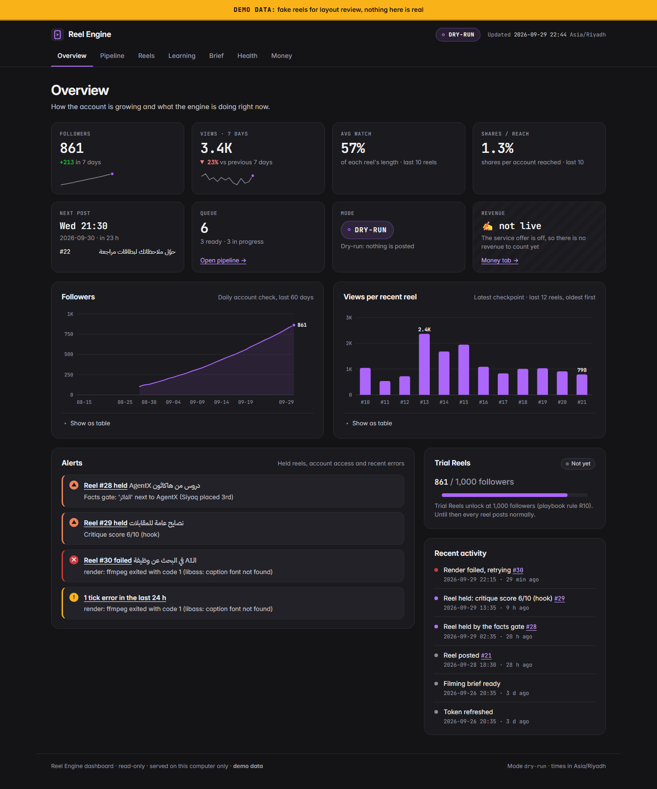
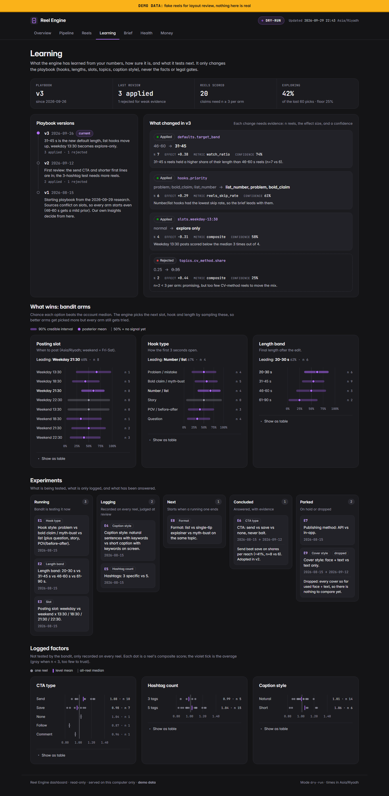

# Reel Engine

An autonomous, self-improving Instagram Reels pipeline for one creator account: Yazeed Almutrif's Saudi-dialect Arabic reels about AI tools and tech careers.

He films a clip and drops it in a OneDrive folder. The engine does everything else:
- cuts the false starts, retakes, fillers and long pauses;
- burns in word-highlighted Arabic captions that render correctly;
- adds a hook card and a cover;
- normalises loudness and runs technical, fact, legal and quality checks;
- writes the caption and hashtags;
- schedules the post into the slot its bandit thinks is best, and publishes through the official Instagram API;
- collects metrics, learns which hooks, lengths and slots work, rewrites its own playbook with evidence, and writes next week's filming brief.

Since 2026-10-14 (branch `feature/calendar-upload-accounts`, see `docs/DECISIONS_PENDING.md`):
- a **Saudi occasions calendar** (Founding Day, Flag Day, National Day, Ramadan and the Eids via the Umm al-Qura calendar, plus international, tech and career days, each with a source): the brief looks 1-3 weeks ahead and the scheduler posts an occasion reel just before or on its day; editable from the dashboard and `reel calendar`;
- an **Upload clip** button in the dashboard that feeds the normal intake path (127.0.0.1 only, CSRF-protected, never publishes);
- **account analysis**: attach your own and reference/competitor accounts, import their public numbers (Business Discovery isn't available on the Instagram-Login path, see `docs/API_NOTES.md`), and the brain's pseudonymised analysis feeds the brief. Privacy: `docs/PRIVACY.md`.

**Status:** built and tested in **dry-run** only. Nothing has been posted; going live needs the owner's recorded OK (see *Safe by design*). Windows only.

> **بالعربية:** «Reel Engine» نظام آلي لحساب ريلز واحد على إنستغرام (محتوى باللهجة السعودية عن أدوات الذكاء الاصطناعي والوظائف التقنية). يصوّر صاحب الحساب المقطع ويرميه في مجلد، والنظام يقص التكرار والتوقفات، ويضيف ترجمة عربية مضبوطة، ويفحص الجودة والحقائق والأنظمة، ويكتب الوصف، ويجدول وينشر عبر واجهة إنستغرام الرسمية، ثم يتعلم من الأرقام ويكتب خطة التصوير للأسبوع الجاي. **الحالة:** مختبر في وضع التجربة (dry-run) فقط، وما نشر شي.

| Dashboard: overview (demo data) | Learning tab (demo data) | A rendered frame (synthetic test clip) |
|---|---|---|
|  |  |  |

The dashboard screenshots use seeded **demo data** (every page carries a DEMO banner). The test clip is synthetic: a text-to-speech Saudi voice over a moving background, made by `scripts/make_test_clip.py`.

## Why it's built this way
- **Human-grade output or no post.** Every reel passes technical QA (codec, loudness −14 LUFS, faststart, black/frozen frames, captions actually burned in), a facts gate that only allows verified facts about the creator (e.g. Siyaq placed **3rd** at AgentX, never "winner"), a legal gate (no engagement bait, guarantees or third-party ads; Saudi Mawthooq rules), and an independent critique that must score ≥ 7. Anything else is held, and he is told why.
- **Learning that's honest.** Thompson-sampling bandits over posting slot, hook type and length, with ≥ 25% exploration early. Claims need n ≥ 3 and a Bonferroni-corrected posterior. An offline simulation shows it converges (`docs/qa/learning-sim.md`), and the learner can't touch the safety gates.
- **Safe by design.** Official API only; tokens only in Windows Credential Manager; the LLM runs with no tools for writing tasks; the dashboard is localhost-only with a strict CSP; idempotent publishing (crash-tested at every step); a kill switch; dry-run by default. `reel mode live` refuses unless `docs/DECISIONS.md` holds a `LIVE-OK` line, a token is stored, `doctor --live` has no FAIL, and the owner types `GO LIVE`.

## Stack
Python 3.10 · hijridate (Umm al-Qura) · faster-whisper large-v3 (CUDA, RTX 4070) · ffmpeg 9 (libass + HarfBuzz + FriBidi, portable) · headless Claude Code CLI as the "brain" (structured JSON output, schema-validated) · SQLite · Jinja2 static dashboard with inline-SVG charts · Instagram API with Instagram Login (v26.0, resumable upload) · Windows Task Scheduler.

## Run it
```powershell
powershell -NoProfile -ExecutionPolicy Bypass -File scripts\setup.ps1     # install / repair: venv, pinned packages, portable ffmpeg, fonts, Whisper model (idempotent)
.venv\Scripts\reel.exe doctor                                               # health check
.venv\Scripts\reel.exe process "C:\path\to\clip.mov"                        # one clip, now
.venv\Scripts\reel.exe dashboard --open                                     # the dashboard (127.0.0.1)
.venv\Scripts\reel.exe dashboard --demo --open                              # the dashboard with demo data
```
**Settings.** Without a `config.toml` the engine runs on `config.example.toml`: dry-run, the inbox in `data/inbox`, vault writes off, and the fictional example brand pack in `brand.example/`. To use it for real, copy `config.example.toml` to `config.toml` (git-ignored), set your inbox, vault and backup folders, and point `brand_dir` at your own brand pack.

**Brand pack.** `brand_dir` holds `facts.yaml` (the only facts captions may state, plus the trap rules), `gates.yaml` (legal rules), `never_say.yaml`, `captions.yaml` (templates, CTA lines, hashtag pool), `hooks.yaml`, `episodes.yaml`, `voice.md`, `styles.yaml` and the starting `playbook_v1.json`. `brand.example/` shows every file for a fictional creator. The prompts in `prompts/` are written for the owner's account; adapt them too if you reuse the engine.

One-time account setup: `docs/SETUP.md`. Every command: `docs/RUNBOOK.md`. Security model: `docs/SECURITY.md`. Instagram API facts: `docs/API_NOTES.md`.

## Tests
```powershell
.venv\Scripts\python.exe -m pytest -q -p no:cacheprovider          # default suite (e2e and real-brain tests are opt-in)
.venv\Scripts\python.exe -m pytest -q -m e2e                         # end-to-end on the synthetic clip (GPU + ffmpeg + model)
```
Results on 2026-10-03 (Windows 11, Python 3.10):
- In the owner's checkout (with his private brand pack): **485 passed**, 2 deselected (the opt-in e2e tests).
- In a clean copy of exactly this repo's files (no `config.toml`, the example brand pack, ffmpeg in `bin/` as `setup.ps1` installs it): **436 passed**, 2 deselected. The difference is the 49 gate tests written around the owner's personal facts, which stay out of the repo; `tests/test_gates_example.py` runs the same gate engine against the example pack.

Results on 2026-10-14 (macOS, Python 3.10, branch `feature/calendar-upload-accounts`, no ffmpeg/GPU, the CUDA and Windows-only wheels left out of the install): **545 passed, 4 skipped, 1 failed**, 2 deselected. The 4 skips need the portable ffmpeg; the 1 failure is `test_vault_refuses_unsafe_paths[..\\escape.md]`, which tests a Windows path separator and fails on macOS before and after this branch (baseline on the same Mac: 431 passed, 4 skipped, 1 failed). ✍️ Not yet re-run on the Windows PC.

## Results (measured in this build)
- The synthetic 39.0 s Saudi-voice test clip (false start, filler, bad retake, long pauses; iPhone-style HEVC HDR, rotated) became a 17.1 s reel with 3 cuts. The brain kept the right takes and fixed an ASR error («سوّ CV»; `docs/qa/e2e/brain-edit-plan-2026-09-29.json`). Critique scores in the passing real-brain run: hook 7, clarity 8, value 7, accuracy 9 (`docs/qa/e2e/real-brain-summary.json`).
- Timing on the RTX 4070: transcription inference 3.2 s (the whole stage, with model load, 12 s), render stage 11 s. Output −14.2 LUFS, true peak −1.3 dB, 1080×1920 H.264 High, 30 fps, faststart, no edit list (`docs/qa/e2e/fake-brain-summary.json`, `docs/qa/e2e/real-brain-qa.json`).
- Learning simulation (200 runs × 90 posts): picks of the best arm rose from chance (12.5–25%) to 44–69% in the last 10 posts; regret was 39% lower than random; 4% false "better" claims when nothing is different.
- Screenshots and frames: `docs/qa/`.

## Not in this repo (kept private on purpose)
- The owner's brand pack (`brand/facts.yaml`, `voice.md`, `hooks.yaml`, `episodes.yaml`, `captions.yaml`, `never_say.yaml`, `playbook_seed.md`, `playbook_v1.json`): personal facts, content plans and strategy.
- `config.toml` (local folders), the build spec, decision log, build report and fact-check report (they quote personal facts), and the gate tests built on those facts.
- Runtime data (`data/`: the SQLite database, clips, renders, logs), the Whisper model (`models/`) and ffmpeg (`bin/`); `setup.ps1` downloads the last two.

## Layout
`reelengine/` code · `prompts/` brain prompts + JSON schemas · `brand/` fonts (OFL) + generic legal gates and caption styles · `brand.example/` fictional brand pack · `scripts/` setup, secrets, tasks, QA tools · `tests/` unit + e2e + mock Graph API · `docs/` setup, runbook, security, API notes, QA evidence · `data/` runtime (git-ignored).

No license has been chosen yet.
