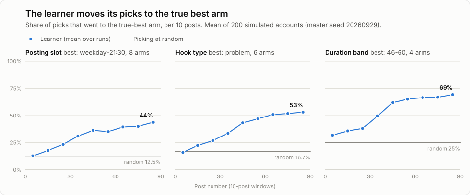
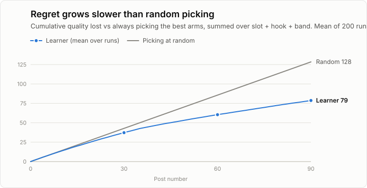

# Learning simulation: does the real learner learn?

Generated 2026-09-29 by `scripts/learning_sim.py` (master seed **20260929**, 200 runs x 90 posts for the main scenario, 200 runs each for the prior-wrong and no-effect scenarios, 54 s).

Reproduce exactly (Windows, from the project root):

```powershell
.venv\Scripts\python.exe scripts\learning_sim.py --seed 20260929 --seeds 200 --posts 90
```

## Headline

- **Posting slot**: picks of the true-best arm go from 13% (posts 1-10) to 44% (posts 81-90); random would be 12.5%. The top posterior arm is the true best in 75% of runs at post 90.
- **Hook type**: picks of the true-best arm go from 16% (posts 1-10) to 53% (posts 81-90); random would be 16.7%. The top posterior arm is the true best in 80% of runs at post 90.
- **Duration band**: picks of the true-best arm go from 32% (posts 1-10) to 69% (posts 81-90); random would be 25%. The top posterior arm is the true best in 85% of runs at post 90.
- **Regret** after 90 posts: 79 vs 128 for random picking (39% less).
- **Exploration** in the first 30 posts: at least 27% in every run and every dimension (rule: >= 25%).
- **No effects, no winner**: with every arm equal, a 'better' claim appears in 4% (slot), 4% (hook_type), 4% (duration_band) of runs at post 90.



## Method

- **Real code, fake world.** Each run makes a fresh in-memory SQLite DB, seeds playbook v1 with `learner.load_playbook`, and then only calls the production functions: `learner.recommend_brief` (a 7-script filming brief whenever the previous one is used up), `scheduler.schedule_reel` (slot choice, all scheduler constraints), `scheduler.due_reels` + `db.transition` (publishing), and `learner.compute_rewards` once a day (composite vs rolling median, baseline of 5, Beta updates). Snapshots use `learner.arm_stats`. Nothing in the learner is re-implemented.
- **Timeline.** One tick per day at 12:00 Riyadh from 2026-10-01. A new reel is made when fewer than 2 are waiting in `scheduled`; it follows the next brief item exactly (hook type + a duration drawn inside the band). Config defaults apply: max 1 post per day, 6 h gap, quiet 00:30-11:00, 20 min lead.
- **World.** Latent quality q = slot effect + hook effect + band effect + noise (sd 0.45). From q: reach (log-normal, grows with followers), views, likes / comments / shares / saves (binomial on reach), average watch time (watch ratio x duration), skip rate in percent (lower when q is high), and follower growth. 3% of reels have no watch time and 5% no skip rate (stored as NULL, like the API); follower_count is NULL under 100 followers (the account starts at 60).
- **Insights** are written as `insights` rows at the 72 h checkpoint (fetched at the first daily tick after 72 h), and one `account_insights` row per day.
- **Logged factors** (CTA, hashtag count, caption style) are random and have no effect.
- **Metrics.** (1) share of picks on the true-best arm per 10-post window (mean over runs); (2) explore share of the first 30 posts; (3) P(top posterior arm = true best) at posts 30/60/90, where top = highest posterior mean alpha/(alpha+beta); (4) cumulative regret = sum over posts and dimensions of (best effect - chosen effect), vs the expected regret of uniform random picks; (5) claims: an arm's `verdict` from `arm_stats` ('better' needs n >= 3 and P(arm beats the pooled rest) >= 1 - 0.05/k).

## Ground truth (hidden from the learner)

| Dimension | Arm | Effect on quality (main) | Effect (prior-wrong run) |
|---|---|---|---|
| slot | `weekday-21:30` **(best)** | +0.50 | +0.50 |
| slot | `weekday-18:30` | +0.20 | +0.20 |
| slot | `weekend-22:30` | +0.10 | +0.10 |
| slot | `weekday-22:30` | +0.00 | +0.00 |
| slot | `weekend-21:30` | +0.00 | +0.00 |
| slot | `weekend-18:30` | -0.05 | -0.05 |
| slot | `weekday-13:30` (bad) | -0.40 | -0.40 |
| slot | `weekend-13:30` (bad) | -0.50 | -0.50 |
| hook_type | `problem` **(best)** | +0.50 | +0.50 |
| hook_type | `list_number` | +0.20 | +0.20 |
| hook_type | `bold_claim` | +0.10 | +0.10 |
| hook_type | `story` | +0.00 | +0.00 |
| hook_type | `question` (bad) | -0.30 | -0.30 |
| hook_type | `pov_before_after` (bad) | -0.40 | -0.40 |
| duration_band | `46-60` **(best)** | +0.40 | +0.00 |
| duration_band | `31-45` | +0.15 | +0.40 |
| duration_band | `20-30` | -0.20 | -0.20 |
| duration_band | `61-90` (bad) | -0.45 | -0.45 |

## Results: main scenario

### (1) Share of picks on the true-best arm, per 10 posts

| Dimension | random | 1-10 | 11-20 | 21-30 | 31-40 | 41-50 | 51-60 | 61-70 | 71-80 | 81-90 |
|---|---|---|---|---|---|---|---|---|---|---|
| slot | 12.5% | 13% | 18% | 23% | 31% | 36% | 35% | 39% | 40% | 44% |
| hook_type | 16.7% | 16% | 22% | 27% | 34% | 43% | 47% | 51% | 52% | 53% |
| duration_band | 25% | 32% | 36% | 38% | 50% | 62% | 65% | 67% | 67% | 69% |

### (2) Exploration in the first 30 posts

| Dimension | mean explore share | lowest in any run |
|---|---|---|
| slot | 45% | 33% |
| hook_type | 40% | 27% |
| duration_band | 36% | 27% |

Every arm is tried once first (coverage), then explore = a 25% coin flip plus a catch-up quota that keeps the running share >= 25%.

### (3) P(top posterior arm = true best)

| Dimension | post 30 | post 60 | post 90 | if random |
|---|---|---|---|---|
| slot | 43% | 56% | 75% | 12.5% |
| hook_type | 54% | 70% | 80% | 16.7% |
| duration_band | 74% | 79% | 85% | 25% |

### (4) Cumulative regret (quality units, all three dimensions)

| After post | learner | random picks | reduction |
|---|---|---|---|
| 30 | 37.3 | 42.8 | 13% |
| 60 | 60.4 | 85.6 | 29% |
| 90 | 78.7 | 128.4 | 39% |



### Claims at post 90

| Dimension | true best called 'better' | another arm called 'better' | any better/worse claim |
|---|---|---|---|
| slot | 32% | 2% | 34% |
| hook_type | 38% | 1% | 40% |
| duration_band | 40% | 2% | 50% |

The bandit exploits long before it is allowed to *claim* anything: claims need strong evidence, exploitation doesn't.

## Results: prior-wrong scenario

The seed playbook gives 46-60 s a mild prior (Beta(2,1)). Here 31-45 s is truly best and 46-60 s is average, to check that the prior doesn't lock the learner in.

| Dimension | 1-10 | 11-20 | 21-30 | 31-40 | 41-50 | 51-60 | 61-70 | 71-80 | 81-90 | top = best @90 |
|---|---|---|---|---|---|---|---|---|---|---|
| slot | 13% | 19% | 21% | 31% | 38% | 41% | 42% | 44% | 48% | 77% |
| hook_type | 16% | 22% | 28% | 35% | 42% | 48% | 50% | 55% | 56% | 82% |
| duration_band | 24% | 31% | 39% | 46% | 58% | 65% | 69% | 72% | 73% | 94% |

Regret after 90: 82 vs 132 random (37% less).

## (5) Sanity run: no true effects

Every arm has effect 0 (200 runs). A learner that hallucinates would call winners here.

| Dimension | runs with a 'better' claim | any better/worse claim | most common top arm (share of runs) | if uniform |
|---|---|---|---|---|
| slot | 4% | 4% | 18% | 12.5% |
| hook_type | 4% | 4% | 22% | 16.7% |
| duration_band | 4% | 4% | 32% | 25% |

The claim rule allows a 5% family-wise false-claim rate per dimension (Bonferroni over its arms); the measured rate stays near or below that. The top posterior arm is spread across arms (the duration band leans to 46-60 s because of its prior). With no effects there is no regret to reduce, so that metric is omitted.

## Honest limits

- **The effects are assumptions.** Arm effects of up to +/-0.5 against reel noise of 0.45 are strong, clean signals. Real slot or hook effects are probably smaller and noisier; the samples needed grow with 1/effect^2, so half-size effects need roughly 4x the posts for the same certainty.
- **One quality drives every metric.** Here all metrics move together. On the real account they can disagree (long reels: lower watch ratio, more saves), which the composite weights then arbitrate.
- **Additive, stationary world.** No hook x length interactions, no topic effects, no Instagram algorithm changes, no seasonality; follower growth is the only drift (and it inflates late wins a little).
- **Perfect compliance.** Every brief item is filmed exactly as recommended, and insights always arrive. In real life reels are filmed late, skipped, or off-brief, and the 72 h data can lag.
- **Scheduling limits exploitation.** With max 1 post per day, a weekday-only best slot can take at most 5 of 7 days; in the sim the queue simply waits for weekdays, which slows posting.
- **Binary reward.** 'Beat the median' ignores how much a reel won by; big hits and small wins count the same.
- **Claims are conservative on purpose.** At 90 posts the learner already exploits the best arm, but it formally calls it 'better' in only about a third to a half of runs.

Charts: `docs/qa/learning-sim.svg`, `docs/qa/learning-sim-regret.svg` (light and dark aware).
